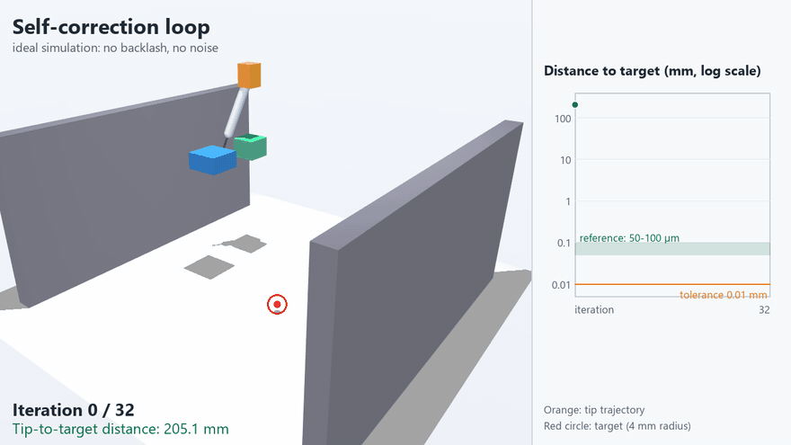

# Monkey with a Scalpel

> Because giving an LLM a robotic arm is like giving a monkey a scalpel. This is the sandbox where we teach it not to cut itself.

An open project to build a **high-precision robotic assistant for laboratory work**, with a large language model acting as a copilot: it proposes trajectories, processes camera images and writes control code. **A human supervises and approves every step.**

The goal is to show, stage by stage and with public evidence, that an agent can iterate and correct itself **inside a system that has physical stops and human review**, not despite them.

## Status

Early stage. Phase 0 is under way: the simulated gantry, the self-correction loop and an error model run and are checked by the CI. The controller firmware core exists and is tested on a PC; it has not run on hardware, and there is no hardware yet. The plan is split into phases, each closed by a joint review with the collaborators before the next one starts.

| Phase | Goal | Material | In this repository |
|---|---|---|---|
| 0 | The agent iterates and self-corrects in simulation | Simulation only | Yes |
| 1 | Move the simulation to real hardware: XYZ gantry, two cameras, syringe actuator | Hardware, no samples | Yes |
| 2 | Validate with synthetic phantoms (gelatin or agarose) and measure position and volume error | Inert materials | Yes |
| 3 | Regulatory and ethical groundwork | Paperwork only | **No** |

**This repository covers Phases 0-2 only.** Nothing here involves animals or biological tissue. Phase 3 is out of the repository: whether and how it happens depends on the permissions of the university and/or the institution involved, and on written approval from the relevant ethics committee and authority. Nothing in Phase 3 will be carried out without them.

## Phase 0 preview: the self-correction loop



The agent closes the loop on the simulated gantry. Each iteration measures the tip-to-target error, computes a capped correction and moves; the distance falls from 205 mm to 0.009 mm in 32 iterations, crossing the 50-100 µm reference band on the way. This is an **ideal simulation**, with no backlash and no camera noise yet. [Full video](docs/media/self_correction_loop.mp4). Code: [`simulation/loop_autocorreccion.py`](simulation/loop_autocorreccion.py).

An error model ([`simulation/error_model.py`](simulation/error_model.py)) and a Monte Carlo sweep ([`simulation/sweep_errores.py`](simulation/sweep_errores.py)) then show where the loop breaks. With assumed values, to be replaced by measurements in Phase 1, it ends below 50 µm in at least 95 % of runs up to about 20 µm of camera noise, 20 µm of calibration bias and 12.5 µm axis steps. Calibration bias is a hard floor that more iterations cannot fix, so camera calibration becomes the most demanding requirement. Backlash had no effect up to 200 µm, which holds only because the loop corrects with the camera and not with the motor position.

## What we are building

- **XYZ gantry** that moves the tool; the sample or phantom stays fixed.
- **Wrist of 0-2 axes** to control the entry angle. On some paths it stays fixed and only the gantry moves; whether it can be an active axis during insertion will be decided from measurements.
- **Own linear actuator** for the plunger of a precision syringe.
- **Two cameras** (top and side) calibrated to millimetres, with a USB microscope as backup if the needle tip needs more resolution.
- **Closed-loop control**: the agent reads the cameras, computes the error, and sends commands to the controller.
- **Modular by intent**: the system is meant to grow with extra syringes (each with its own wrist), other tools, sensors such as photometry or fluorescence, and a wash station. That is beyond Phases 0-2, but it shapes decisions now: a standard quick-change tool interface, firmware organised by modules, named positions (park, wash, samples) and cameras independent of the tool.

There is no fixed pass mark. The minimum acceptable is to beat a steady human hand, whose involuntary tremor is taken here as a working benchmark of 50-100 µm (published figures vary with the task, the metric and whether the wrist is supported, so the benchmark will be defined precisely and cited before any comparison is made). Beyond that, errors in position and volume are driven as low as the hardware allows, and every phase measures and publishes what it achieves with its uncertainty. Dispensed volumes are around 1 µL, measured with an analytical balance, camera images and the syringe scale.

## Principles

- **Human in the loop.** The agent proposes; a person approves. The agent never acts on hardware by itself.
- **Safety first.** The design calls for two separate controls: an abort button, handled by the controller rather than the computer, that withdraws the needle along its axis and parks the tool at configured coordinates; and an emergency stop that cuts motor power independently of the computer and the firmware. Limit switches and a communication watchdog complete it. Each layer is tested before the next step.
- **Simulation before hardware, inert materials before anything else.** No step is skipped.
- **Open by default, with limits.** See [PUBLIC_POLICY.md](PUBLIC_POLICY.md).

## How the project is run

Planning lives on a task board managed with [Histos](https://github.com/AIAYN-creator/Histos), kept outside this repository. Every card is worked as a proposal: the agent drafts, automated checks run, and the project owner approves or rejects. Decisions that matter (simulator, mechanics, electronics, specifications) are discussed with the collaborators, a pharmacist, a researcher and a veterinary/welfare adviser, and one person signs them off.

## A note on tooling

The agent in this project is Claude. The author has not been able to work on it with Opus 5.5, Anthropic's frontier model: the project gets flagged by its safety systems. The work is done with Sonnet 5.5 instead. It is mentioned here for transparency, because it shapes how the agent-assisted parts of the project are carried out.

## Repository layout

`simulation/` exists; the rest is planned and not yet created:

```
simulation/   Phase 0: simulator models and the self-correction loop
firmware/     Phase 1: controller firmware core (tested on a PC; no board layer yet)
vision/       Phases 1-2: camera capture, calibration, detection
cad/          Phase 1: provisional parametric CAD (no real measurements yet; do not print)
docs/         Decisions and results from each phase
```

## Contributing

Issues and discussion are welcome. Please read [CONTRIBUTING.md](CONTRIBUTING.md) and [PUBLIC_POLICY.md](PUBLIC_POLICY.md) first; they explain how changes land on the protected `main` branch and what must never be committed (credentials, personal data, anything from Phase 3).

## Getting started

```
python -m venv .venv
.venv\Scripts\activate        # on Linux or macOS: source .venv/bin/activate
pip install -r requirements.txt
python simulation/test_instalacion.py
python simulation/sim_brazo.py
python simulation/loop_autocorreccion.py
python simulation/sweep_errores.py --runs 20
```

To look at a MuJoCo model in an interactive window: `python -m mujoco.viewer --mjcf=path/to/model.xml`.

## License

[MIT](LICENSE), copyright AIAYN-creator.
