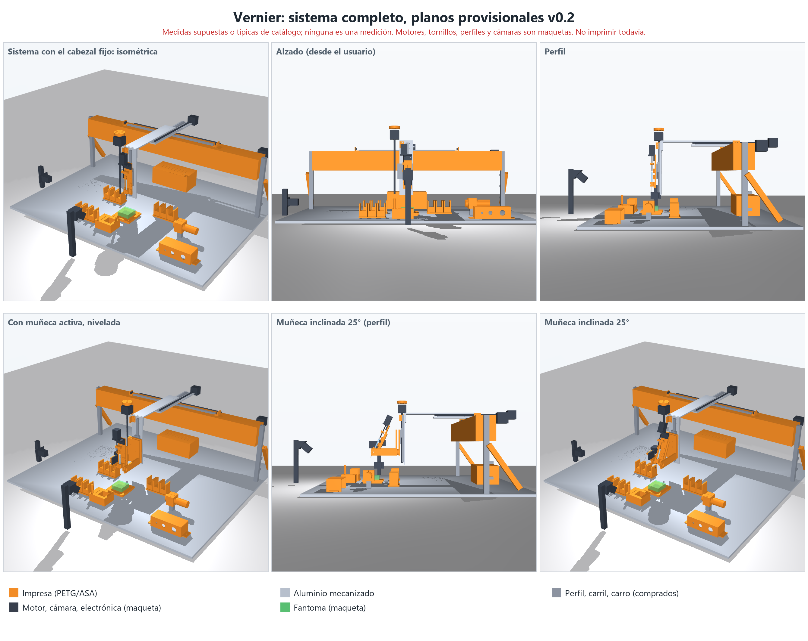
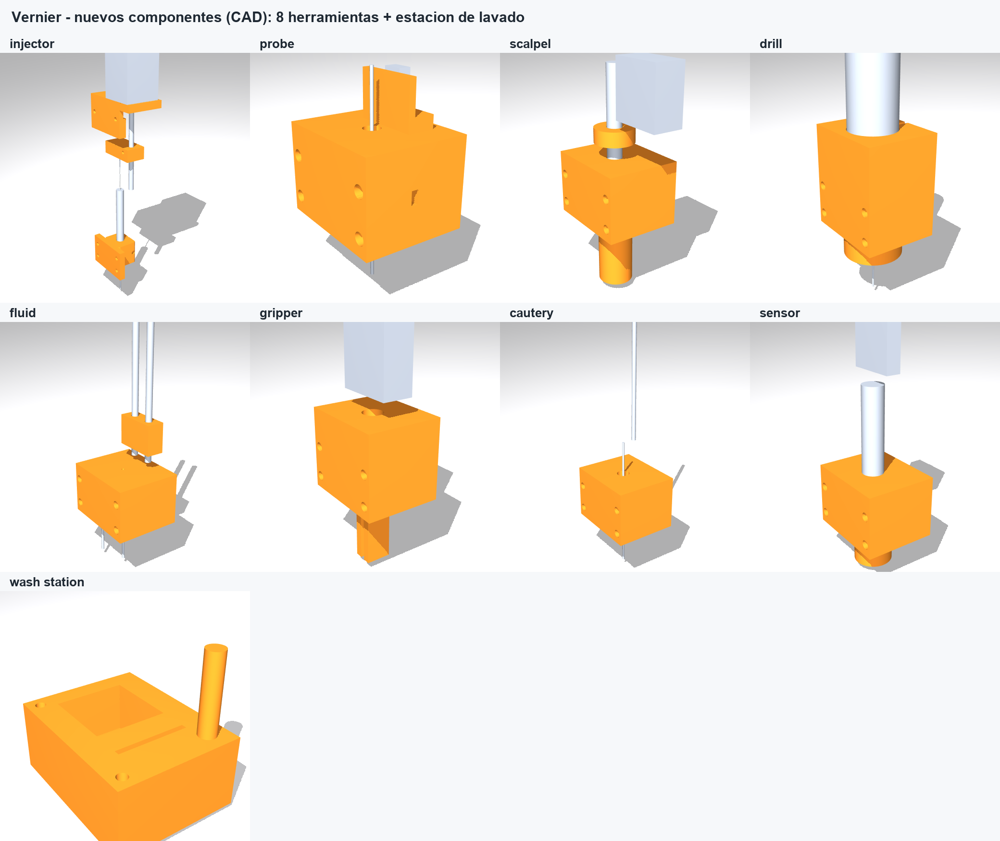

<p align="center">
  <picture>
    <source media="(prefers-color-scheme: dark)" srcset="assets/brand/wordmark-dark.png">
    
  </picture>
</p>

<p align="center"><b>Read finer than the ruler.</b><br>An open robotic lab assistant with an LLM copilot and a human who approves every step.</p>

# Vernier

*Working name; the project started as "Monkey with a Scalpel".* A vernier scale reads between the marks of the ruler: that is what this project does with cameras and a closed loop, reading finer than the mechanics resolve. See [`assets/brand/`](assets/brand/README.md).

> Because giving an LLM a robotic arm is like giving a monkey a scalpel. This is the sandbox where we teach it not to cut itself.

An open project to build a **high-precision robotic assistant for laboratory work**, with a large language model acting as a copilot: it proposes trajectories, processes camera images and writes control code. **A human supervises and approves every step.**

The goal is to show, stage by stage and with public evidence, that an agent can iterate and correct itself **inside a system that has physical stops and human review**, not despite them.

## Status

Early stage, still in simulation and design: **nothing here has run on hardware, and no real measurement exists yet.** What exists today:

- **Simulation (Phase 0):** the simulated gantry, the self-correction loop and an error model, checked by the CI.
- **Controller firmware:** a hardware-independent C++ core with limits, a communication watchdog and an abort that withdraws the tool, plus a provisional board layer for an ESP32-S3 with one TMC2209 driver per axis. Both compile (the board layer for `esp32s3`) and are tested on a PC. A mutation check injects 21 faults, one at a time, into the core, the step queue and the pin map, and the tests must catch every one; it runs in the CI.
- **CAD:** a provisional parametric model of the whole system (62 parts: frame with diagonal braces and a printed hollow crossbeam with four aluminium rods, three axes, an optional active two-axis wrist (B with a worm drive, A as a stage), tool head, two cameras and a microscope, controls, electronics enclosure, cable clips, a specimen fixture and a heater-plate parameter). It is a registry of modules, so parts can be developed in parallel. It has geometric checks (interferences at the corners of the travel and in the wrist swing, camera line of sight) and a first-order mechanical calculation, but no finite-element analysis and no real measurements. **Do not print yet.**
- **Wiring map:** cables, conductor counts, estimated lengths and the moving harness, checked against the firmware pins.
- **Host software** (all tested in the CI, none run on hardware): `host/coords/` (sample frames, camera calibration, triangulation), `host/link/` (serial protocol, session, heartbeat, hash-chained log), `host/toolsim/` (behaviour models of the eight tools and the wash station, with the limits read from their descriptors), `host/overlay/` (camera overlay on simulated frames: tip, target, error, firmware state, anatomical coordinates, each with how it was computed) and `host/llm/` (the interface for a language model: it fetches papers and proposes anything, with no quota; a person approves each proposal bound to its hash; machine plans use a list of capabilities and an advisory validator with no AI; narration and a log; the model is replaceable by a script).
- **Plan:** a card board with a batch of 36 cards (decisions, software, one module per tool, integration and tests), arranged so independent work can run in parallel without clashing. It is kept outside this repository.

The plan is split into phases, each closed by a joint review with the collaborators before the next one starts. **Phase 1 now covers the whole tool family, not only the syringe: everything must work before Phase 1 closes, and Phase 2 does not start without that.** If a tool is not built for budget or feasibility, it is simulated and its code, model and tests are prepared anyway, and the project records which tool and why.

| Phase | Goal | Material | In this repository |
|---|---|---|---|
| 0 | The agent iterates and self-corrects in simulation | Simulation only | Yes |
| 1 | Real hardware and a modular tool interface: XYZ gantry, active wrist, cameras and microscope, and every tool module (injector, contact probe, scalpel, drill, fluidics, gripper, cautery, optical sensors), built or simulated; plus the camera-overlay software and the LLM interface | Hardware, inert test pieces | Yes |
| 2 | Validate every tool and full sequences on synthetic phantoms and substitute materials (gelatin, agarose, synthetic skin), and measure position, volume and force error | Inert materials | Yes |
| 3 | Regulatory and ethical groundwork | Paperwork only | **No** |

**This repository covers Phases 0-2 only.** Nothing here involves animals or biological tissue. Phase 3 is out of the repository: whether and how it happens depends on the permissions of the university and/or the institution involved, and on written approval from the relevant ethics committee and authority. Nothing in Phase 3 will be carried out without them.

## Phase 0 preview: the self-correction loop


The agent closes the loop on the simulated gantry. Each iteration measures the tip-to-target error, computes a capped correction and moves; the distance falls from 88 mm to 0.009 mm in 26 iterations, crossing the 50-100 µm reference band on the way. This is an **ideal simulation**, with no backlash and no camera noise yet. [Full video](docs/media/self_correction_loop.mp4). Code: [`simulation/loop_autocorreccion.py`](simulation/loop_autocorreccion.py).

An error model ([`simulation/error_model.py`](simulation/error_model.py)) and a Monte Carlo sweep ([`simulation/sweep_errores.py`](simulation/sweep_errores.py)) then show where the loop breaks. With assumed values, to be replaced by measurements in Phase 1, it ends below 50 µm in at least 95 % of runs up to about 50 µm of camera noise (the largest level that passed; the next, 100 µm, did not), 20 µm of calibration bias and 12.5 µm axis steps. Calibration bias is a hard floor that more iterations cannot fix, so camera calibration becomes the most demanding requirement. Backlash had no effect up to 200 µm, which holds only because the loop corrects with the camera and not with the motor position.

## What we are building

- **XYZ gantry** that moves the tool, with 100 mm of useful travel per axis today. The CAD takes the travel per axis (`VERNIER_TRAVEL="x,y,z"`); the study (`cad/mech_review.py`) shows that an automatic tool change and wash need a large travel, about 300 to 400 mm in X, and a layout where the tool rack and the wash station are inside it; the sample or phantom stays fixed. Printed parts wherever stiffness allows.
- **Active wrist** (two axes: B, the rotation about X, is designed with a worm drive that holds its angle with the power off; A, about Y, is next) to control the entry angle, controlled open loop and watched by the cameras. It is the default design; the earlier fixed-wedge option stays as a fallback. With the wrist the tip has a minimum height, because the yoke arms straddle the needle.
- **Interchangeable tools on one quick-change interface**: an injector (precision syringe with its own linear actuator), a contact probe, a scalpel with a depth stop, a micro-drill, aspiration/irrigation/dispensing, a gripper, a cautery and optical sensors (fluorescence, photometry), with a wash station and a tool rack. Only the injector exists as a design so far. The tool contract (not written yet) will have each tool declare its capabilities, its geometry and its safe state, the firmware refuse a tool it does not know, and the tool power be switched by the same contactor as the emergency stop.
- **Cameras**: two cameras (one oblique, one lateral) calibrated to millimetres, plus a USB microscope as an extra view.
- **Closed-loop control**: the agent reads the cameras, computes the error, and sends commands to the controller.
- **Camera-overlay software** that shows what the cameras see (detected tip, target, error, firmware state, named coordinate frames), and **an LLM interface** where the model is free to read papers and propose whatever it judges useful, never raw motors: a person approves every proposal before anything moves, and a validator without AI only advises. Both are simulated and tested; a real model client and the video source are not written yet.
- **Modular by design**: a standard tool interface, firmware organised by modules, named positions (park, wash, samples), cameras independent of the tool, and a CAD split into modules that can be worked on in parallel.

There is no fixed pass mark. The minimum acceptable is to beat a steady human hand, whose involuntary tremor is taken here as a working benchmark of 50-100 µm (published figures vary with the task, the metric and whether the wrist is supported, so the benchmark will be defined precisely and cited before any comparison is made). Beyond that, errors in position and volume are driven as low as the hardware allows, and every phase measures and publishes what it achieves with its uncertainty. Dispensed volumes are around 1 µL, measured with an analytical balance, camera images and the syringe scale.

## The CAD



The crossbeam is a hollow printed box in segments with aluminium rods (the large orange beam above). The eight tools and the wash station, drawn as printed parts (orange) around bought ones:



All renders, with what each one shows, are in [docs/cad](docs/cad/README.md); the wiring is in the [connection map](docs/connection_map.md). Every size is provisional and nothing should be printed yet.

## Principles

- **Human in the loop.** The agent proposes; a person approves. The agent never acts on hardware by itself.
- **Safety first.** The design calls for two separate controls: an abort button, handled by the controller rather than the computer, that withdraws the tool along its own axis and parks it at configured coordinates; and an emergency stop that cuts motor and tool power through a contactor, independently of the computer and the firmware. Limit switches, a communication watchdog and a per-tool safe state complete it. The firmware safety rules are covered by tests and a mutation check. Each layer is tested before the next step, and none of this is certified safety software.
- **The model proposes without limits, a person approves.** The LLM is free to read and to propose; it never sees raw motors, and nothing acts without a human approval bound to the exact proposal.
- **Simulation before hardware, inert materials before anything else.** No step is skipped.
- **Open by default, with limits.** See [PUBLIC_POLICY.md](PUBLIC_POLICY.md).

## How the project is run

Planning lives on a task board managed with [Histos](https://github.com/AIAYN-creator/Histos), kept outside this repository. Every card is worked as a proposal: the agent drafts, automated checks run, and the project owner approves or rejects. Decisions that matter (simulator, mechanics, electronics, specifications) are discussed with the collaborators, a pharmacist, a researcher and a veterinary/welfare adviser, and one person signs them off.

## A note on tooling

The agent in this project is Claude. The author has not been able to work on it with Opus 5.5, Anthropic's frontier model: the project gets flagged by its safety systems. The work is done with Sonnet 5.5 instead. It is mentioned here for transparency, because it shapes how the agent-assisted parts of the project are carried out.

## Repository layout

`simulation/`, `firmware/`, `cad/` and `host/` exist; `vision/` is planned and not yet created:

```
simulation/   Phase 0: simulator models, the self-correction loop and the error model
firmware/     core/ (motion and safety, no hardware headers), board/ (ESP32-S3 sketch, pin map), tests/ (host tests and the mutation check)
cad/          provisional parametric CAD: modules/ (one file per group of parts), layout.py, build.py, wiring.py, mech_review.py (no real measurements; do not print)
vision/       planned: camera capture, calibration, detection
host/         coords/ (sample frames, camera calibration); planned: control layer on the PC, camera-overlay viewer, LLM interface
docs/         media and results from each phase
```

## Contributing

Issues and discussion are welcome. Please read [CONTRIBUTING.md](CONTRIBUTING.md) and [PUBLIC_POLICY.md](PUBLIC_POLICY.md) first; they explain how changes land on the protected `main` branch and what must never be committed (credentials, personal data, anything from Phase 3).

## Getting started

```
python -m venv .venv
.venv\Scripts\activate        # on Linux or macOS: source .venv/bin/activate
pip install -r requirements.txt
python simulation/test_instalacion.py
python simulation/sim_brazo.py
python simulation/loop_autocorreccion.py
python simulation/sweep_errores.py --runs 20
```

To look at a MuJoCo model in an interactive window: `python -m mujoco.viewer --mjcf=path/to/model.xml`.

Firmware tests (a C++17 compiler is needed) and the mutation check:

```
g++ -std=c++17 -Wall -Wextra -Werror -O2 -Ifirmware/core firmware/core/controller.cpp firmware/tests/test_controller.cpp -o test_controller
./test_controller
python firmware/tests/mutation_check.py
```

The CAD needs `pip install -r requirements-cad.txt`; then `python cad/build.py out` builds the parts and runs every geometric check, and `python cad/wiring.py --check` checks the wiring map against the firmware pins. See [firmware/README.md](firmware/README.md) and [cad/README.md](cad/README.md).

## License

The project is licensed in layers, and each folder carries its own `LICENSE` file:

| What | Folders | Licence |
|---|---|---|
| Software | [firmware/](firmware/LICENSE), [host/](host/LICENSE), [tools/](tools/LICENSE), [simulation/](simulation/LICENSE) | [GNU AGPL-3.0](LICENSE) |
| Hardware designs and documentation | [cad/](cad/LICENSE), [docs/](docs/LICENSE) | [CERN-OHL-S v2](cad/LICENSE) (strongly reciprocal) |
| Name and logo | [assets/](assets/LICENSE) | All rights reserved, see [TRADEMARKS.md](TRADEMARKS.md) |

The software is also available under a [commercial licence](COMMERCIAL-LICENSE.md) for use without the AGPL's obligations. Contributions
need the [contributor grant](CLA.md). Versions up to commit `82339bb` were published under the MIT License and stay available under it
([LICENSES/MIT-historical.txt](LICENSES/MIT-historical.txt)). The full notices are in [NOTICE](NOTICE). Not legal advice: have a lawyer
review the terms before you build a business on them.
